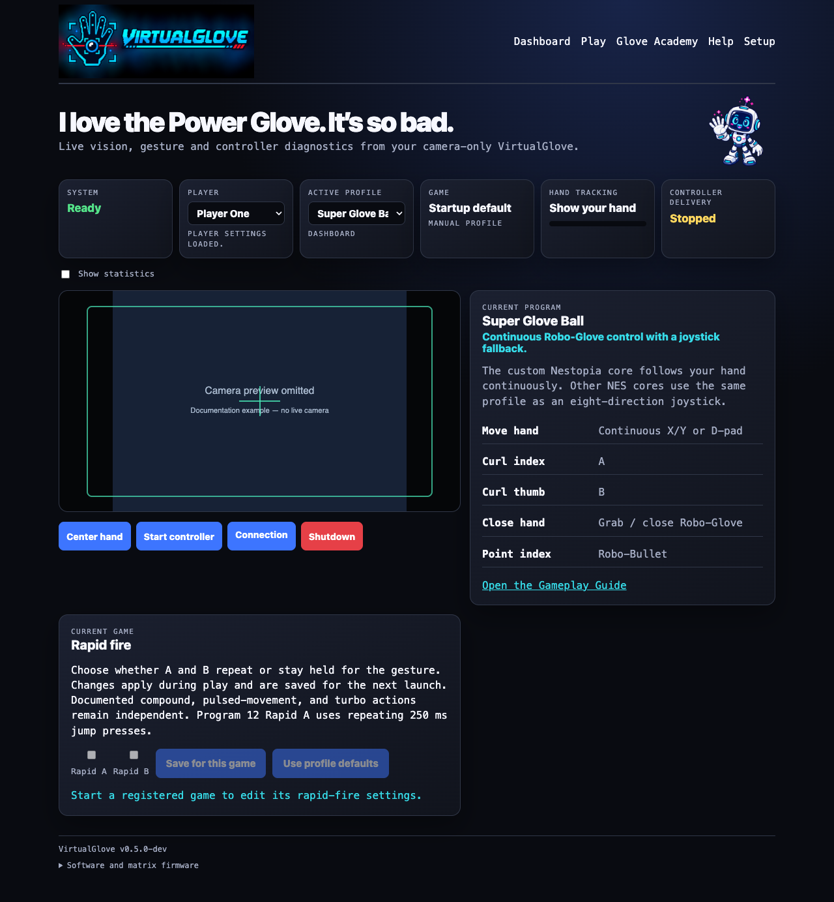

<p align="center">
  
</p>

# VirtualGlove

VirtualGlove is a camera-driven input system for supported RetroArch games. An Arduino UNO Q processes a USB camera feed, maps tracked hand movement and gestures to a game profile, and sends authenticated control state to a receiver on the game system. A glove may improve visibility, but it contains no electronics.

Camera frames stay on the controller. The game system receives control state, while Controller Router combines that state with a physical pad for routed Linux games. Pixel Pal and Glove Academy provide local calibration and gesture practice.

## Functional scope

- Play supported NES games with Programs 1–14 and A–I, including game-specific gesture mappings and rapid-fire exceptions.
- Use FCEUmm joystick mode, or the separate Nestopia (VirtualGlove) core for Super Glove Ball’s native movement and glove actions.
- Learn all 16 movement and gesture lessons with Pixel Pal in **Glove Academy** before sending input to a game.
- Save each player’s hand centre, movement reach, gesture sensitivity, camera choices, and Academy progress.
- Use **Play** for a camera-controlled Rock Paper Scissors practice game without a console session.
- Keep physical controls alongside hand input. During a routed launch, hand input waits until the hand has returned to neutral so a menu gesture does not become the first game action.



The stable release is **v0.7.0**. The commands below select the latest published stable release; prereleases require their exact versioned assets. The same platform installer handles a first install and an upgrade. See the [0.7.0 changelog](docs/CHANGELOG.md#070---2026-11-14) and the guide included with the downloaded release. Release candidate **v0.7.1-rc.3** adds console pairing security fixes and a lower console CPU load; see the [0.7.1 changelog](docs/CHANGELOG.md#071---in-preparation).

## System boundary

| Stage | Runs on | Output or responsibility |
| --- | --- | --- |
| Camera and tracking | UNO Q | Local video capture and hand landmarks; raw frames are not sent to the console |
| Profile and gesture engine | UNO Q | Movement and button state for the selected game or practice mode |
| Controller Router | UNO Q and Linux console | Authenticated pairing, one active input lease, player assignment, and shared Matrix display |
| Game receiver | RetroPie, Recalbox, Batocera, or LaunchBox | Virtual gamepad or native input for the selected emulator; physical controls remain available |

The shared Router library is 0.3.0 and its UNO Q portal is 0.3.3. LaunchBox uses VirtualGlove's separate Windows input path. The release packages do not include games or BIOS files.

## What you need

- A provisioned Arduino UNO Q with Arduino App Lab, a UVC USB camera, and a powered USB hub.
- A supported game system: RetroPie, Recalbox 10.x, Batocera 38 or newer, or LaunchBox on 64-bit Windows with 64-bit RetroArch.
- A physical gamepad already configured on the game system, and your own legally obtained games. No ROMs or BIOS files are included.
- Both devices on the same trusted local network, with internet access during installation.

Start with [Build Your Own](docs/BUILD_YOUR_OWN.md) if you are choosing hardware.

## Install or upgrade

Close any game before installing. Keep the backup location printed by the installer until you have checked your setup afterward. The [Installation Guide](docs/INSTALL_README.md) covers each platform's questions, checks, and recovery steps.

### Controller

In a terminal on the controller, signed in as `arduino`:

```sh
cd /home/arduino
curl -fLO https://github.com/mathan416/VirtualGlove/releases/latest/download/install-uno-q.sh && bash install-uno-q.sh
```

The installer prints the controller's `.local` and IP addresses. The first shared Matrix build can take several minutes. Controller Router owns the port-80 entry page and Matrix display; the VirtualGlove site is on port **8100**.

### RetroPie

In its terminal as the normal RetroPie user, with EmulationStation and games closed:

```sh
cd "$HOME"
curl -fLO https://github.com/mathan416/VirtualGlove/releases/latest/download/install-retropie.sh && bash install-retropie.sh
```

### Recalbox 10.x

In its terminal as `root`:

```sh
cd /recalbox/share/system
curl -fLO https://github.com/mathan416/VirtualGlove/releases/latest/download/install-recalbox.sh && bash install-recalbox.sh
```

### Batocera 38 or newer

In its terminal as `root`:

```sh
cd /userdata/system
curl -fLO https://github.com/mathan416/VirtualGlove/releases/latest/download/install-batocera.sh && bash install-batocera.sh
```

### LaunchBox on Windows

Install 64-bit Python and 64-bit RetroArch with FCEUmm first. Download `VirtualGlove-LaunchBox.zip` from the latest release and follow the [Installation Guide's LaunchBox steps](docs/INSTALL_README.md). Its managed RetroPad runs beside physical XInput and the keyboard; the shared Linux Controller Router setup described below does not replace LaunchBox's input path.

## Connect and play

Controller Router comes with VirtualGlove. Open the controller address printed by the installer. With VirtualGlove alone it opens the app; with R.O.B. Vision too, **Apps** lets you choose. Both app services stay available. Starting a registered game selects its app automatically, even when no browser is open.

Pair the console once by choosing **Pair console** from Apps. The console installer opens a short connection window and prints a one-time code. Router's secure Setup page verifies the console and asks for a confirmation code shown on the Matrix display. It provisions separate private credentials for installed apps, so adding R.O.B. Vision later does not require a second pairing. See the [Controller Router Pairing Guide](controller_router_portal/python/guides/Controller-Router-Pairing-Guide.pdf). LaunchBox follows its platform-specific pairing instructions in the Installation Guide.

Use **Players and Systems** to put a physical pad on Player 1 and choose which Libretro systems use Router. New Router configurations enable NES; upgrades keep saved choices. **My existing setup** preserves a system's usual controls. Configure a physical pad's buttons in EmulationStation before assigning its player in Router. On RetroPie, VirtualGlove's separate gamepad path remains an option; Recalbox and Batocera use merged players for routed games.

In VirtualGlove **Setup**, centre your hand and check the camera. **Glove Academy** teaches the gestures without sending accidental game input. Registered games select their profile automatically. FCEUmm supplies joystick-mode NES controls; the separately named **Nestopia (VirtualGlove)** path gives Super Glove Ball its native movements and actions. A physical controller remains available for menus and exit controls. See [Game and Gesture Guide](docs/GAMEPLAY_GUIDE.md) and [Input Modes](docs/INPUT_MODES.md).

## Help and guides

| To do this | Read this |
| --- | --- |
| Install, pair, update, or recover | [Installation Guide](docs/INSTALL_README.md) |
| Learn gestures and game controls | [Game and Gesture Guide](docs/GAMEPLAY_GUIDE.md) |
| Choose players or keep a system's controls | [Controller Router Guide](docs/CONTROLLER_ROUTER.md) |
| Choose and tune a camera | [Camera Guide](docs/CAMERA_GUIDE.md) |
| Recognise Matrix display cues | [Matrix Display Guide](docs/MATRIX_GUIDE.md) |
| Fix a symptom | [Troubleshooting](docs/TROUBLESHOOTING.md) |
| Print a case | [Enclosure Guide](docs/ENCLOSURE_GUIDE.md) |
| Understand the design | [Architecture](docs/ARCHITECTURE.md) and [Engineering Journey](docs/ENGINEERING_JOURNEY.md) |

The controller serves user guides, technical references, and PDFs from **Help**. Printable editions are also in [output/pdf](output/pdf/). The [public website](website/UPLOAD_README.txt) is maintained in this repository.

## Runtime data flow


1. The camera delivers its newest frame to the controller.
2. Hand tracking recognises palm, wrist, and finger landmarks.
3. The selected profile turns movements and gestures into game controls.
4. The controller sends authenticated state to its paired game system.
5. The console publishes the appropriate RetroArch or native glove input.

Controller Router keeps physical player assignments stable for routed games and grants one app's input at a time. If a wireless pad sleeps and wakes, Router reconnects that source to its saved player. If Router itself restarts during a game, exit and relaunch after it is ready. See its [User Guide](controller_router_portal/python/guides/Controller-Router-User-Guide.pdf) and [Technical Reference](docs/ARCHITECTURE.md).

## Validation and maintenance

The release packages validate their contents and print post-install checks and any actions still needed on the device. Keep the installer's backup location until the controller and console have been checked; a UNO Q payload backup is not a whole-system rollback. See the [Installation Guide](docs/INSTALL_README.md) for recovery.

Run `python3 -m unittest discover -s tests` in a source checkout. CI also checks JavaScript, package composition, PDF assets, and supported Python versions. Test reports should name the controller, console platform, emulator/core, game, physical pad and camera, because a package build does not establish gameplay on every hardware combination.

## Contribute and licence

Issues, careful test reports, and contributions are welcome. Read the [Contributing Guide](docs/CONTRIBUTING.md), [Changelog](docs/CHANGELOG.md), and [Third-Party Notices](THIRD_PARTY_NOTICES.md). VirtualGlove is maintained by **Iain Bennett** under the [MIT License](LICENSE); the modified Nestopia core is separate GPLv2 software. Nintendo, NES, Power Glove, and named games belong to their respective owners.
